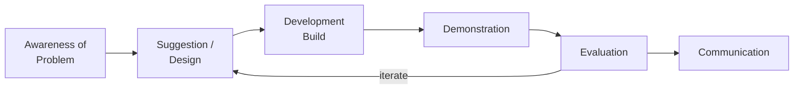
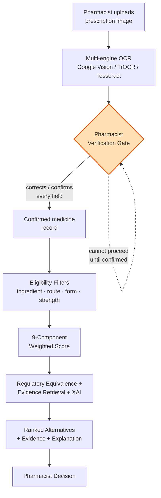
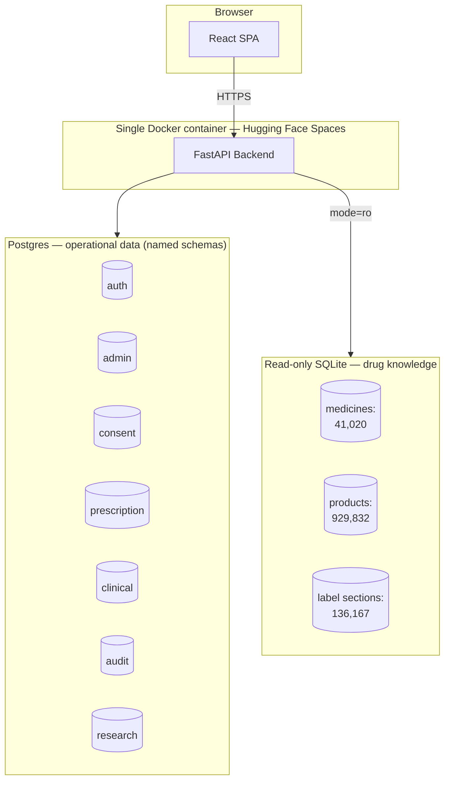
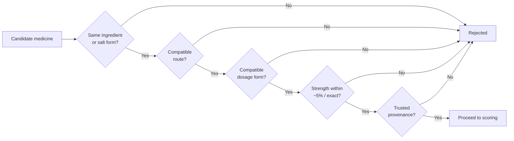
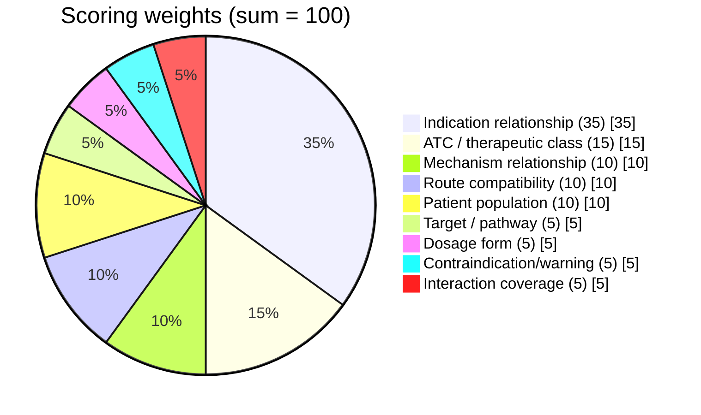
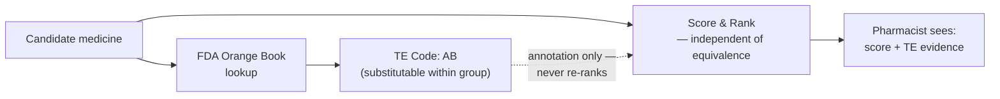
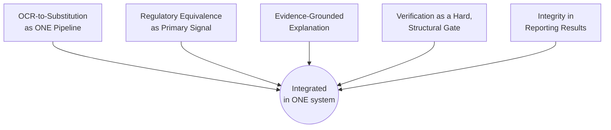

<!--
MediScan — Final Project Presentation
PGD in Generative AI, Batch 5 FALL I 2025
NED University of Engineering & Technology (CMPP)
Student: Muhammad Usama Alam | Roll No./Enrolment No.: [TO CONFIRM] | Supervisor: Sajid Majeed

Format notes for later PPT/HTML conversion:
- Each "## Slide N: Title" is one slide. Content below it is that slide's body.
- Mermaid code blocks render as diagrams natively in many markdown viewers
  (GitHub, VS Code, Claude artifacts) and can be exported as images for PPT.
- [SCREENSHOT: ...] markers show where to insert an actual app screenshot
  (captured separately from the live demo — not part of this markdown).
- Target: ~22 slides, ~20-minute presentation (Annexure F: 20 min talk + 20 min viva).
- Slide order follows Annexure F's required template exactly: Title -> Name/Batch/Roll No. ->
  Introduction -> Objectives -> Scope of work -> Literature Review -> Methodology -> Findings ->
  Conclusions -> Recommendations -> Thank you. (Name/Batch/Roll No. is folded into the Title slide
  here rather than a separate slide; Findings is distributed across several slides since it covers
  several distinct results.)
- On converting to PPT: add the two official NED University crest/seal images to the title slide,
  alongside "NED ACADEMY" and "Karachi, Pakistan" text, per the Annexure F title-slide template.
-->

## Slide 1: Title

**MediScan**
A Human-in-the-Loop, Explainable AI Decision-Support System for
Prescription Reading and Therapeutically-Equivalent Medicine Substitution

NED Academy — Centre of Multidisciplinary Postgraduate Programmes
NED University of Engineering & Technology, Karachi, Pakistan

Postgraduate Diploma in Generative AI — Batch 5, FALL I 2025

Student: Muhammad Usama Alam · Roll No./Enrolment No.: *[TO CONFIRM]*
Supervisor: Sajid Majeed

<!-- [LOGO PLACEHOLDER: both official NED University crest/seal images, per Annexure F title-slide template] -->

---

## Slide 2: Introduction — The Problem

Two connected problems pharmacists face every day, with no formal tool support:

1. **Reading the prescription correctly.** Handwritten prescriptions are common; look-alike/sound-alike drug names turn a single misread character into a different medicine entirely.
2. **Finding a substitute when the prescribed medicine isn't available.** Out of stock, discontinued, or unaffordable — the pharmacist must judge a therapeutically appropriate alternative on the spot.

A third, cross-cutting problem: any automated tool here must **earn trust**. An answer without a reason is not safe to act on in a clinical setting.

---

## Slide 3: Project Objectives

1. Multi-engine OCR pipeline — extract medicine name, strength, form, route
2. **Mandatory** pharmacist verification before anything downstream runs
3. Recommendation engine — trusted catalogue + eligibility filters + transparent score
4. Regulatory therapeutic-equivalence layer (FDA Orange Book)
5. Evidence-grounded explanations (FDA label text)
6. Explainable-AI attribution — show *why* a score was given

<!-- Speaker note: close with the cross-cutting commitment — no metric or claim is reported unless real data backs it. Kept off-slide to hold the line count. -->

---

## Slide 4: Scope of Work

**In scope:**
- OCR extraction + mandatory pharmacist verification gate
- 9-component recommendation scoring + FDA Orange Book evidence
- Evidence-grounded explanation + explainable-AI (XAI) attribution
- Role-based access: pharmacist / reviewer / administrator — self-registration with mandatory administrator approval before activation, full audit trail

**Out of scope:**
- No autonomous prescribing, dispensing, or automatic substitution
- No real patient data or PII — synthetic prescriptions only
- Not a clinical source of truth; drug–drug interaction checking is future work
- Research-grade prototype, not a production clinical system

---

## Slide 5: Literature Review

| Research strand | What the literature establishes | Where MediScan sits |
|---|---|---|
| Prescription OCR | Mature for print; handwriting is harder, and look-alike/sound-alike drug names are a documented, separate error class | Joins OCR to a *substitution decision*, not just transcription |
| Therapeutic equivalence | Equivalence is a regulatory determination (FDA Orange Book), not something inferred from chemical similarity alone | Equivalence is the *primary* ranking signal — not a heuristic afterthought |
| Explainable AI | Interpretable-by-design is preferable to post-hoc explanation of a black box for high-stakes decisions (Rudin, 2019) | Score is additive — exact attribution, not an approximation |
| Evidence grounding (RAG) | Retrieval-augmented generation reduces unsupported claims versus an unconstrained LLM (Lewis et al., 2020) | Withholds the narrative entirely when no evidence is found |
| Human-in-the-loop | Confirmation placed *after* a system already acts invites automation bias / rubber-stamping (Parasuraman & Manzey, 2010) | Verification gate enforced *before* any recommendation is generated |

**Research gap:** each of these five properties is addressed separately in prior work — no existing system integrates all five together. (Full review: report Chapter 2.)

---

## Slide 6: Methodology — Design Science Research

- Build → Demonstrate → Evaluate, iterated (Hevner et al., 2004; Peffers et al., 2007)
- Fits this project because the research question **requires** a constructed artefact to answer
- Mixed evaluation: quantitative (OCR accuracy, ranking quality) + qualitative (pharmacist trust)

---

## Slide 7: End-to-End System Flow

**The verification gate is the safety center of the system** — enforced on the server, not just the UI. *(Regulatory equivalence, evidence retrieval and XAI each get their own slide shortly.)*

---

## Slide 8: Why the Gate Comes *Before* Recommendations

- If recommendations appeared first, the pharmacist would be reviewing a system that already committed to an interpretation → invites **rubber-stamping** (automation bias)
- By gating *first*, every downstream step is conditioned on a human-verified field
- Enforced twice: disabled button in the UI, **and** the recommendation API itself filters to only `status = confirmed` medicine rows

[SCREENSHOT: Verification table — field-by-field confirm/correct interface]

---

## Slide 9: System Architecture

Two data stores, deliberately separated: operational state (writable, 7 named schemas incl. `admin` for the registration/approval workflow) vs. drug knowledge (read-only — cannot drift or be corrupted by application bugs).

---

## Slide 10: The Drug Knowledge Catalogue (Real Scale)

| Source | Role | Rows Ingested |
|---|---|---|
| FDA National Drug Code (NDC) | Product listings: name, strength, form, route | 132,824 |
| DrugBank | Active ingredients, salt forms, chemical IDs | 4,953 |
| FDA Structured Product Labeling | Evidence-retrieval corpus (label text) | 255,904 |
| FDA Orange Book | Therapeutic equivalence codes | — |

**Result:** 41,020 medicines · 929,832 product records · 373,959 name aliases · 136,167 label sections — a real, substantial catalogue, not a demo stub.

---

## Slide 11: The Recommendation Engine — Mandatory Filters First

Hard gates, not scores — a candidate failing **any one** filter never reaches the scoring stage *(design intent; see Limitations for where current enforcement needs tightening)*.

---

## Slide 12: The Nine-Component Transparent Score

Additive by design: each component awards full weight or none. The total is an **exact arithmetic fact**, not an approximation — this is what makes the explanation layer genuinely exact rather than a guess about a black box.

*(Narrate in tiers: one dominant component at 35 → one at 15 → three at 10 → four rounding out the total at 5 each.)*

---

## Slide 13: Regulatory Equivalence — FDA Orange Book (Passive Evidence)

**Design principle:** regulatory determination is evidence the pharmacist reads — not an instruction that silently changes the ranking. Structural/chemical similarity is a subordinate signal, never the primary one.

---

## Slide 14: Evidence Grounding & Explainability

- Evidence retrieved from FDA label text (Structured Product Labeling) — production path uses **keyword/token-overlap** matching (fast, deterministic, auditable); a semantic/embedding retriever exists and is evaluated separately
- **No evidence found → no narrative generated.** The system shows "insufficient evidence" rather than letting an LLM fabricate a summary
- An optional LLM narrative layer (Groq) exists but is **off by default** — with it off, the pharmacist sees the retrieved excerpts plus the 9-component breakdown, with no LLM involved at all
- Explanation = the exact 9-component breakdown behind the score (not a post-hoc approximation of an opaque model)

[SCREENSHOT: Recommendation card — score breakdown + evidence excerpt + equivalence badge]

---

## Slide 15: Worked Example — A Real Query Against the Real Catalogue

**Input:** Ibuprofen 200 mg, oral tablet, for pain and inflammation

| Rank | Candidate | Score | Type |
|---|---|---|---|
| 1 | Naproxen | 100/100 | Different active ingredient |
| 2–5 | Celecoxib, Prednisone, others | 70/100 | Different active ingredient |

- Naproxen: full marks across all 9 components; real DrugBank mechanism-of-action evidence retrieved; real FDA Orange Book AB-rating (167 products) attached as evidence
- Every layer — filters, scoring, equivalence, evidence, explanation — executed end-to-end and produced a traceable result against the real catalogue, not a mocked stand-in

*(The filter stage's route/dosage-form gating is itself one of the refinements this exact example surfaced — see Limitations. Finding this by running a real query, not just by reading the code, is itself a point in favor of an interpretable, inspectable design.)*

---

## Slide 16: What Has Been Built and Verified Working

- ✅ Full pharmacist workflow, live and publicly deployed
- ✅ Verification gate — confirmed as a genuine **server-side** constraint, not just a UI affordance
- ✅ 9-component scoring model — confirmed to sum to exactly 100
- ✅ Regulatory equivalence layer — confirmed passive (annotation only)
- ✅ Evidence-withholding behavior — confirmed (no evidence → no fabricated narrative)
- ✅ Real drug-knowledge catalogue at production scale (900K+ product records)

---

## Slide 17: Evaluation Status

- 4 pre-registered research questions — OCR accuracy (RQ1), recommendation quality (RQ2), evidence grounding (RQ3), pharmacist trust (RQ4) — each with a metric + threshold fixed **before** running any evaluation
- RQ1 & RQ2: current evaluation harnesses need redirecting — RQ1 to the real single-engine production accuracy signal, RQ2 to the structural-similarity coverage metric — not simply more data at larger scale
- RQ3 & RQ4: evaluation infrastructure (harnesses, honest "unavailable vs. zero" status model, ground-truth audit trail) is built and operational; completing the dataset (RQ3) and obtaining ethics approval plus a pharmacist panel (RQ4) is the immediate next step

*(Consistent with the project's integrity rule: a metric is reported only when real data backs it.)*

---

## Slide 18: Known Limitations — Reported Honestly

- Chemical-similarity bonus still influences ranking on one candidate path — needs reconciling with the "regulatory-first" principle
- Evidence/explanation layer isn't purely passive — withholding a narrative when evidence is insufficient already shapes what the pharmacist sees
- Nine-component scoring model structurally diverges from an earlier internal 3-component specification — needs supervisor sign-off as an approved amendment
- Audit trail is append-only **by convention**, not yet enforced at the database level
- Two concrete filter/scoring refinements surfaced by the worked example (route/dosage-form gating; graded vs. binary component credit)
- Equivalence data is jurisdiction-specific (not directly portable across regulators)

*A system examined this closely, and reported on this honestly, is the point of Design Science Research — not a weakness to hide.*

---

## Slide 19: Contribution

The research gap (Slide 5): these five properties exist separately in the literature. This project demonstrates they can be **built together, in one working system** — and documents where the integration still needs work.

---

## Slide 20: Conclusions

The design is buildable, internally coherent, and deployed — a **disciplined demonstration** of integration rather than yet a fully validated performance claim. Every layer was exercised end-to-end on a real query against the real catalogue; what remains is evaluating it at scale.

---

## Slide 21: Recommendations

1. Complete the 25–30 case synthetic evaluation dataset (RQ3)
2. Redirect RQ1 to the real single-engine accuracy signal and RQ2 to structural-similarity coverage, then re-run both
3. Obtain ethics approval → recruit pharmacist panel → RQ4
4. Resolve the two supervisor-facing design questions (evidence-layer passivity; scoring-model specification divergence) and the filter/scoring refinements from the worked example

---

## Slide 22: Thank You

**Questions & Discussion**

MediScan — live at: *[deployment URL — confirm before sharing with faculty]*

Muhammad Usama Alam
Supervisor: Sajid Majeed
